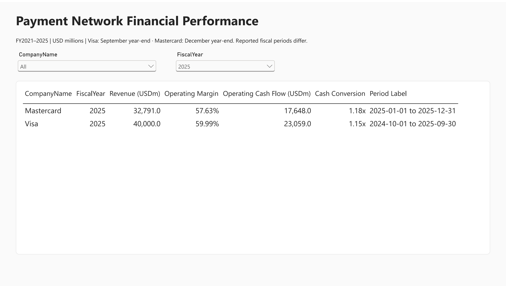
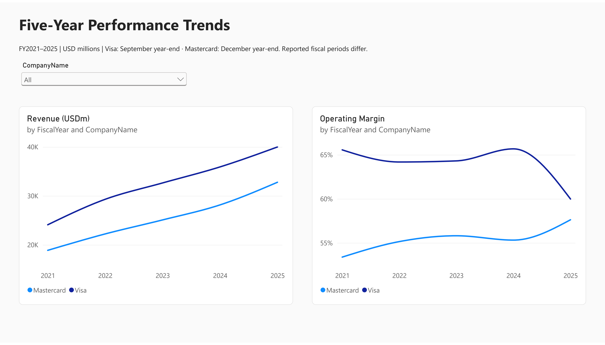
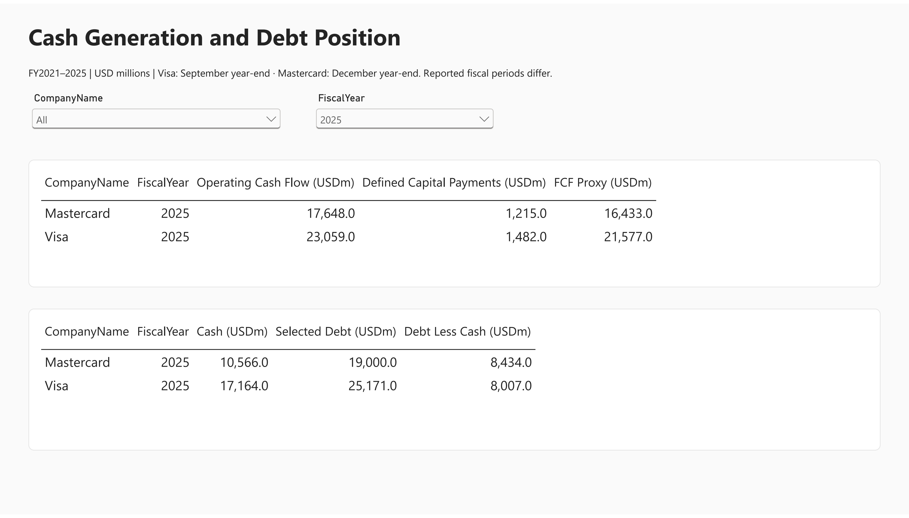
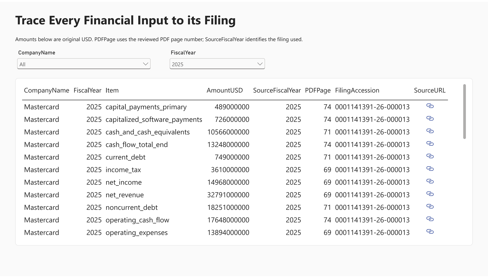
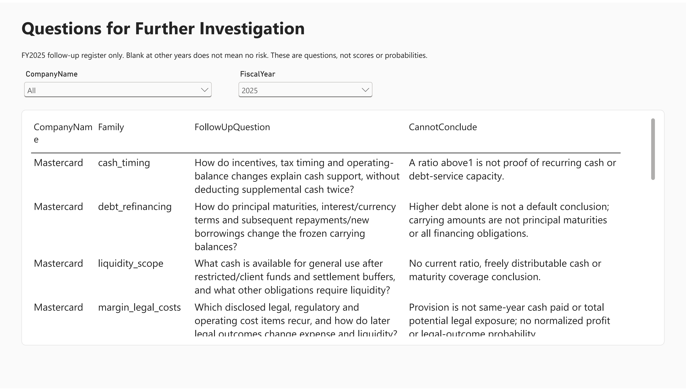
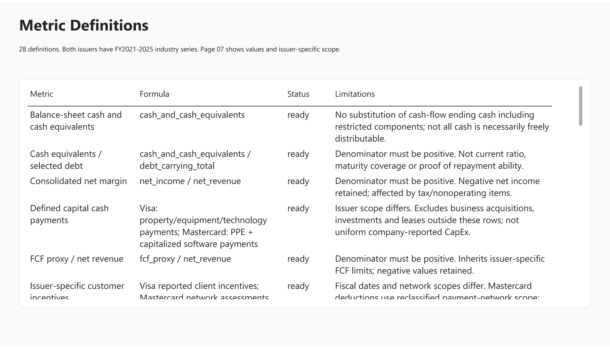
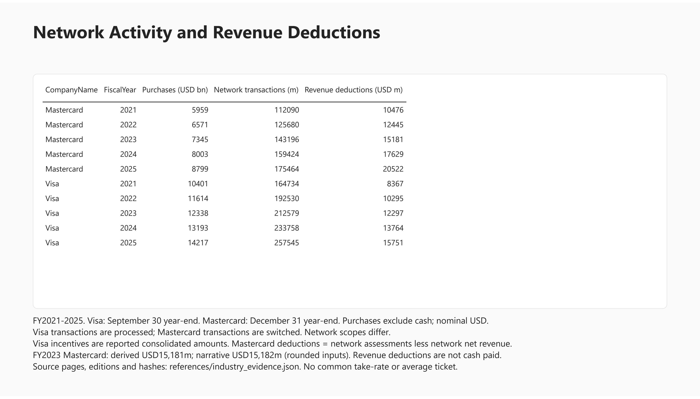

# Payment Network Financial Performance & Risk Analytics

How did Visa and Mastercard perform from FY2021 to FY2025, and what is behind the changes? I built the comparison from public SEC filings and annual reports, then made an Excel model to test simple growth and margin scenarios.

- Visa's FY2025 revenue grew 11.34%, but its operating margin fell 5.69 percentage points to 59.99%. More than half of the cost increase came from a larger litigation provision. I kept what the reports state separate from what still needs checking.
- Debt rose at both companies on the measure I used, but cash rose by more, so debt minus cash went down. Available cash and repayment dates still need a separate review.
- In the Excel model, 4% revenue growth with a 56% operating margin would give Visa USD 23,296m in operating income, below the actual USD 23,994m. These are my own assumptions, not company forecasts.

## Results

- [Notebook with saved outputs](Payment_Financial_Analysis.ipynb) · [Python modules](src/)
- [SQL queries](analysis.sql)
- [Power BI report](Payment_Financials.pbix)
- [Dashboard pages as PDF](Dashboard.pdf)
- [Excel KPI and scenario model](Financial_KPI_and_Scenario_Model.xlsx)
- [Decision memo](reports/11_financial_memo.md) · [One-page PDF version](Financial_Decision_Memo.pdf)

## Data and scope

Visa's fiscal year ends in September and Mastercard's in December, so the years are not calendar-aligned. Payment volume, transaction counts and incentive figures follow each company's own definitions, so they are compared side by side rather than combined. Quarterly results after FY2025 are not included.

[SEC EDGAR API](https://www.sec.gov/search-filings/edgar-application-programming-interfaces) · [Source attribution](ATTRIBUTION.md)

## Run

The notebook is saved with its outputs, so it can be read on GitHub without running anything. Raw source files and the local SQLite model are not included in this repository (see Data and scope). Re-running the notebook requires downloading the sources first.

```bash
pip install -r requirements.txt
```

## Dashboard

Report pages are below. Click an image to open its full resolution.

### 01 Overview

[](images/01_overview.png)

### 02 Performance Trends

[](images/02_performance_trends.png)

### 03 Cash Debt

[](images/03_cash_debt.png)

### 04 Source Traceability

[](images/04_source_traceability.png)

### 05 Follow Up Questions

[](images/05_follow_up_questions.png)

### 06 Metric Definitions

[](images/06_metric_definitions.png)

### 07 Industry Activity

[](images/07_industry_activity.png)
